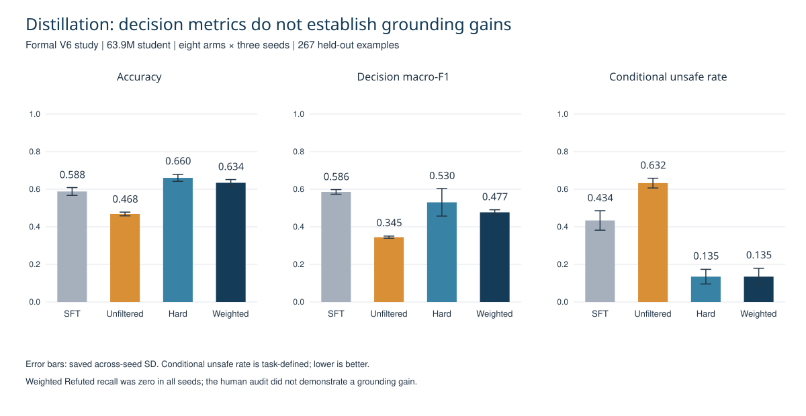

# Multi-Teacher Distillation: Decision Shifts and Failure Analysis

Faculty-advised research at the University of Illinois Urbana-Champaign examining whether correctness-gated multi-teacher rationale distillation improves a compact student's decisions and generated evidence grounding.

**Finding:** filtering and weighting improved selected decision metrics over unfiltered distillation, but the study did not demonstrate grounding gains or a reproducible decision advantage of continuous weighting over hard selection. Label collapse was a central failure mode.



## My project work

I built the three-role teacher-generation, candidate-scoring, student-training, and evaluation workflow; conducted multi-arm, multi-seed experiments; and documented the failure analysis. The project was advised by UIUC faculty. The public preprint lists Xiaofei Feng as sole author.

## Study design

- 4,330 training sources: 353 human-gold and 3,977 weak/silver.
- 12,990 teacher responses from three roles.
- 882 human-adjudicated examples across train, development, and test.
- Formal V6 study: 63.9M-parameter student, eight supervision arms, three seeds, 24 runs, and 267 held-out examples.
- Follow-up development studies with 104.0M-parameter students.

```text
Source examples → Three-role teacher responses → Correctness gate
                                      ↓
                 Unfiltered / hard-filtered / weighted supervision
                                      ↓
                         Compact-student training
                                      ↓
            Decisions + label recall + conditional risk + human audit
```

## Selected formal-study results

| Supervision | Accuracy | Decision macro-F1 | Conditional unsafe-action rate |
|---|---:|---:|---:|
| SFT-only control | 0.588 | 0.586 | 0.434 |
| Unfiltered MTD | 0.468 | 0.345 | 0.632 |
| Hard-filter MTD | 0.660 | 0.530 | 0.135 |
| Weighted MTD | 0.634 | 0.477 | 0.135 |

Weighted-minus-unfiltered accuracy was +16.6 percentage points; the task-defined conditional unsafe-action rate fell 49.8 percentage points. These are combined filtering/weighting effects, not the isolated effect of continuous weights.

The weighted arm had zero Refuted recall in all three seeds; two seeds produced only NotEnoughInfo for the claim task. The human audit did not demonstrate a grounding gain, and source pairing was not established for the small positive-output comparison.

## Why the negative result matters

Aggregate accuracy and lower conditional risk can accompany loss of label functionality. Hard selection and the SFT-only control prevent a weak unfiltered baseline from being mistaken for evidence that continuous weighting is the best method.

In the terminal follow-up, all 24 crossfit/full decision-rule checks, label retention, and safety checks passed, but primary and mechanism feasibility checks failed. The overall scientific attempt failed; the 24 component checks do not establish research success.

## Evidence and reproducibility

- [Correctness-gated supervision construction](scripts/student_v6/build_verifier_core_supervision_v6.py), [hierarchical student trainer](scripts/student_v5/train_hierarchical_student_v5.py), and [frozen 24-run launcher](scripts/student_v6/run_formal_matrix_v6.py).
- [Sealed prediction evaluation](scripts/student_v6/evaluate_grounded_predictions_v6.py) and [human-audit scoring](scripts/student_v6/score_blinded_grounding_audit_v6_availability_amendment.py).
- [All eight arms: automatic decision results](results/decision_results.csv).
- [Human-audit summary](results/human_audit_summary.csv).
- [Terminal checks and overall status](results/terminal_checks.json).
- [Reproduction levels and study-version boundaries](docs/REPRODUCIBILITY.md).
- [Audited source hashes](results/source_manifest.json).

This repository includes 38 original source/configuration files for the formal V6 pipeline, aggregate tables, and public audit protocols. Raw human-adjudicated rows, model weights, generated input manifests, and the external MiniMind implementation are not included. The code snapshot is inspectable; independent end-to-end training reproduction still requires those inputs and a validated environment. See the [implementation map](docs/IMPLEMENTATION.md).

## Preprint

Xiaofei Feng. *Decision Shifts, Lost Label Functionality, and an Inconclusive Grounding Audit in Correctness-Gated Multi-Teacher Distillation.* arXiv:2609.09702, 2026. [Paper](https://arxiv.org/abs/2609.09702).

Status: arXiv preprint. No peer-reviewed acceptance is claimed.

## Quick result check

Python 3, standard library only:

```sh
python scripts/verify_results.py
```

This verifies exported tables, not model training or raw-output correctness.
